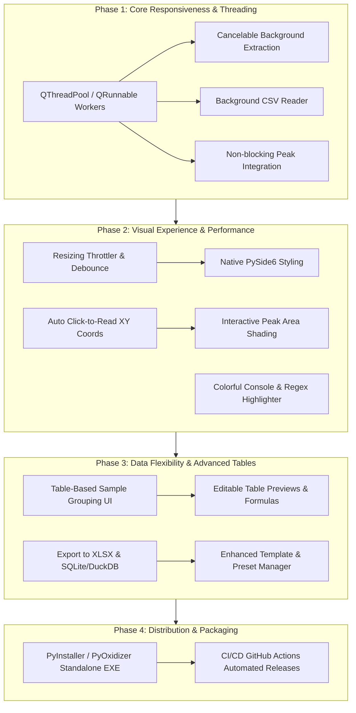
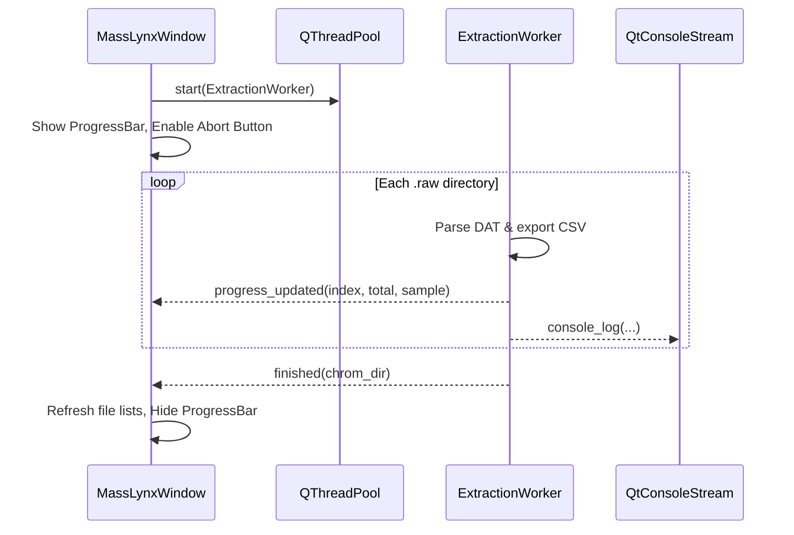

# Waters Data Extractor & Integrator: Development Roadmap & TODO

This document outlines the planned feature additions, performance optimizations, architectural enhancements, and development roadmap for the `waters-data-extractor` project.

---

## 1. Executive Summary & Phasing Overview

The roadmap is organized into **four strategic phases**, designed to deliver immediate stability and responsiveness gains first, followed by visual/interaction upgrades, data persistence enhancements, and standalone packaging.



---

## 2. Granular Feature Breakdown & Action Items

### 2.1 Multi-Threading & Asynchronous Processing (High Priority ⚡)
**Current State:**
- Extraction (`extract_clicked` in `Waters_Integrator_plot.py`) and Integration (`integrate_clicked`) run directly on Qt's main GUI thread.
- `QApplication.processEvents()` is used as a temporary workaround, which causes UI jitter, unresponsive OS warnings, and potential re-entrancy race conditions.

**Target Architecture:**
- Implement a worker architecture using `QThreadPool` and `QRunnable` (or `QThread` with custom signals).
- Communication via Qt Signals (`progress(int current, int total, str status)`, `sample_done(str name)`, `error(str err)`, `finished(dict result)`).



**Task Checklist:**
- [x] Create `ExtractionWorker(QRunnable)` and `IntegrationWorker(QRunnable)` (implemented in Part 6 of AIO script).
- [x] Implement an `AbortFlag` / atomic cancellation token (`CancellationToken`) to allow users to stop long extraction runs cleanly.
- [x] Add a `QProgressBar` and `Abort` button to the main status bar for extraction and batch integration.
- [x] Move CSV loading in Section 03 (`load_plot_csv`) to a lightweight background task (`CsvLoaderWorker`) so opening a 100 MB m/z file does not freeze the interface.

---

### 2.2 Native PySide6 GUI Robustness & OS Styling
**Current State:**
- The application sets custom CSS stylesheets in `Waters_Integrator_plot.py`, which can override native Windows/macOS/Linux widget drawing and cause subtle rendering glitches or inconsistent button metrics across OS versions.

**Target Architecture:**
- Transition from heavy QSS rules to native `QPalette` roles, `QStyle` primitives, and standard system style engines (Windows 11 Mica/Fluent or Fusion).
- Decompose monolithic `MassLynxWindow` into modular components:
  - `ExtractionSectionWidget`
  - `IntegrationSectionWidget`
  - `PreviewSectionWidget`
  - `ExportSectionWidget`
  - `ConsoleDrawerWidget`

**Task Checklist:**
- [ ] Refactor stylesheets to rely on native `QApplication.setStyle()` and refined `QPalette` colors without overriding border/padding of native buttons.
- [ ] Connect system theme change notifications (`QApplication.styleHints().colorSchemeChanged`) dynamically across all platforms.
- [ ] Modularize UI sections into separate classes inheriting from `QWidget` to reduce code duplication between `Waters_Integrator_plot.py` and `Waters_Integrator_exporter.py`.
- [ ] Standardize keyboard shortcuts (e.g., `Ctrl+O` for Browse RAW, `Ctrl+E` for Extract, `Ctrl+I` for Integrate, `Ctrl+P` for Export Plot).

---

### 2.3 Interactive Peak Area Shading on Actual Chromatograms
**Current State:**
- Section 02 only draws vertical shaded tolerance boxes (`axvspan`).
- Section 03 displays line traces or bar charts, but does not display where peaks were integrated or highlight evaluated areas.

**Target Architecture:**
- In Section 02 preview: Render the calculated baseline line $y_{\text{baseline}}(x)$ from $(x_0, y_0)$ to $(x_1, y_1)$, mark the apex point with an annotation marker, and shade the integrated peak region using `axes.fill_between(x[left:right], y[left:right], y_baseline, alpha=0.35)`.
- In Section 03 preview: If `00_evaluated_data.csv` exists in the folder, add a toggle **"Overlay Integrated Peaks"**:
  - Automatically match the currently displayed chromatogram with its corresponding evaluated peak row.
  - Draw filled polygons under the detected peaks with floating labels showing calculated area and apex retention time.

**Task Checklist:**
- [ ] Update `integrate_peak_asym()` to optionally return full peak diagnostic geometry: `(area, apex_x, apex_y, left_x, left_y, right_x, right_y, baseline_coords)`.
- [ ] Update Section 02 canvas drawing to render baseline vectors and `fill_between` peak polygons.
- [ ] Add `Overlay evaluated peaks` checkbox in Section 03 plot preview controls.
- [ ] Link `00_evaluated_data.csv` table rows with the plotted chromatograms.

---

### 2.4 Auto-Enable Click-to-Read XY Coordinates (Streamlined Canvas Interaction)
**Current State:**
- Matplotlib coordinates are only accessible if the user manually checks "Plot controls" to show `NavigationToolbar2QT`.

**Target Architecture:**
- Auto-enable mouse event listeners (`motion_notify_event` and `button_press_event`) on `FigureCanvasQTAgg` without requiring the toolbar.
- Display a real-time HUD badge / status bar readout: `RT: 3.421 min | Signal: 0.184 AU`.
- Support click-to-pick: Clicking a peak in the preview automatically populates the `Retention time (min)` input in Section 02.

**Task Checklist:**
- [x] Implement `canvas.mpl_connect("motion_notify_event", self._on_plot_canvas_hover)` / `_on_integration_canvas_hover` for non-intrusive coordinate tracking.
- [x] Implement lightweight crosshairs (using vertical line guideline update on hover).
- [x] Implement `canvas.mpl_connect("button_press_event", self._on_plot_canvas_click)` / `_on_integration_canvas_click`:
  - Left-click on preview populates retention time target center input; double-click directly adds target.
- [x] Keep toolbar toggle checkbox for advanced pan/zoom when explicitly required.

---

### 2.5 Canvas Performance Modes & Resize Throttling
**Current State:**
- Matplotlib `draw_idle()` or `draw()` runs on every resize event or splitter movement. On large datasets (e.g. 100,000+ scan points), dragging the splitter causes frame drops and UI stutter.

**Target Architecture:**
- Implement a **Resize Debouncer**: When resizing the window or splitter handles, suppress full matplotlib redraws until dragging ceases (`QTimer.singleShot(150ms)`).
- Implement an **Adaptive Decimation Engine**: When displaying high-density chromatograms (>20,000 points), downsample for the preview using min-max binning or LTTB (Largest-Triangle-Three-Buckets), while preserving raw precision for peak integration.
- Provide a **Performance Mode** toggle in the menu: "Smooth Preview (Decimated)" vs "High Precision (Raw)".

**Task Checklist:**
- [x] Wrap canvas redrawing in a `QTimer` single-shot debounce filter (150ms) during window and splitter resize events.
- [x] Efficient non-blocking cursor/hover updates with dynamic crosshairs.
- [x] Add downsampling helper `decimate_trace(times, intensities, max_points=10000)` with peak-preserving min-max binning for preview rendering.
- [x] Add "Performance mode" preference toggle in Section 03 and user settings.

---

### 2.6 Table-Based Sample Grouping UI (Replacing `pattern => folder` Strings)
**Current State:**
- Grouping rules are typed into a multiline `QTextEdit` using `*pattern* => subfolder` or `regex => \g<group>`.
- Users frequently encounter syntax errors, missing `=>`, or unescaped backslashes.

**Target Architecture:**
- Replace the raw string edit with an interactive `QTableWidget` / `QTableView`:
  - Column 1: `Enabled` (Checkbox)
  - Column 2: `Match Pattern` (e.g., `*blank*` or `(?P<batch>\w+)_\d+`)
  - Column 3: `Destination Subfolder` (e.g., `controls` or `\g<batch>/replicates`)
  - Column 4: `Rule Type` (Wildcard / Regex)
  - Column 5: `Matched Count` (Live count of matching samples in selected root)
- Provide `+ Add Rule`, `- Remove Rule`, `▲ Move Up`, `▼ Move Down` buttons.
- Include a "Switch to Raw Text" toggle for power users who prefer bulk copy/pasting.

**Task Checklist:**
- [ ] Design and implement `GroupingRulesTableWidget`.
- [ ] Add validation delegates with real-time regex syntax checks (highlight cell in red if regex is invalid).
- [ ] Add live sample preview counters next to each rule.
- [ ] Maintain backward compatibility by supporting serialization to/from JSON and the legacy string format.

---

### 2.7 Editable Table Previews with Formula / Function Support
**Current State:**
- The CSV table preview in Section 03 (`csv_preview_table`) is read-only (`EditTrigger.NoEditTriggers`).

**Target Architecture:**
- Implement an editable mode toggle: "Preview Mode" vs "Edit Mode".
- When in Edit Mode:
  - Users can edit values directly or enter formulas (e.g., `=A1*10`, `=NORM()`, `=LOG10()`).
  - Column operations toolbar:
    - Multiply / divide column by factor (e.g., dilution factor correction).
    - Subtract baseline blank.
    - Normalize column (0 to 100% or to internal standard).
  - Undo/Redo support using `QUndoStack`.
  - "Save As..." or "Save Changes to CSV" action.

**Task Checklist:**
- [ ] Create `EditableCsvTableModel(QAbstractTableModel)` to replace fixed `QTableWidget` for memory-efficient handling of large CSVs.
- [ ] Implement formula parser supporting basic arithmetic and transform functions (`LOG`, `SQRT`, `OFFSET`, `SCALE`).
- [ ] Add column context menu: "Normalize column", "Apply factor", "Set as retention time".
- [ ] Add Save/Export modified table buttons with validation dialogs.

---

### 2.8 Export to XLSX and Database (SQLite / DuckDB)
**Current State:**
- The workspace exports to CSV (`00_evaluated_data.csv`, `*_nm.csv`, etc.) and Veusz (`.vsz`) / LabPlot (`.lml`).
- CSV lacks formatting, multiple worksheets, or relational queries.

**Target Architecture:**
- **Excel Export (`.xlsx` via `openpyxl`):**
  - Multi-sheet workbook:
    - Sheet 1: `Integrated Summary` (styled header, frozen panes, Excel Named Table `IntegratedDataTable`, auto-filters, wavelength-specific conditional cell fills & badges enabling native "Filter by Color", embedded openpyxl bar chart).
    - Sheet 2: `Substance Mapping` (interactive helper sheet: `SubstanceMappingTable` mapping RT windows to substance IDs like '13' or '203' with roles and response factors, plus `ConversionCalculationTable` computing dynamic conversion %, area ratios P/SM, and total peak areas via live cross-sheet formulas).
    - Sheet 3: `Target Parameters` (retention time targets, tolerance windows, start/end bounds).
    - Sheet 4: `Metadata` (software version, run timestamp, target summary, statistics).
- **Database Export (`.sqlite` / `.duckdb`):**
  - Relational schema:
    - `runs`: Run metadata, instrument, date, root folder.
    - `samples`: Sample name, group subfolder, file paths.
    - `integrated_peaks`: Target center, tolerance, apex RT, computed area, baseline bounds.
    - `spectral_data`: Optional time/intensity series for fast SQL retrieval.
  - Enables longitudinal tracking across different experiment batches.

**Task Checklist:**
- [x] Implement `export_evaluated_to_excel(evaluated_df, targets, output_path)` with professional styling (multi-sheet workbook, custom headers, auto-fit columns, native openpyxl bar chart).
- [x] Add Excel Named Tables (`IntegratedDataTable`, `SubstanceMappingTable`, `ConversionCalculationTable`) with native auto-filtering and structured references.
- [x] Add wavelength-specific pastel conditional formatting and channel badges for native Excel "Filter by Color".
- [x] Implement dedicated `Substance Mapping` worksheet linking RT windows to substance IDs (e.g. '13', '203') with dynamic cross-sheet formulas for conversion % and area ratios.
- [x] Add Excel export buttons in Section 02 (Integration Evaluator) and Section 03 (Plot Data Table Previewer).
- [ ] Create `core/database.py` with SQLite schema creation and insertion routines.
- [ ] Add "Export to SQLite Database" dialog with option to append to an existing database.

---

### 2.9 Enhanced Templates and Recent-Items Functionality
**Current State:**
- Settings are saved in a single JSON file and QSettings.
- Templates store a flat dict, and recent targets only store retention time triples.

**Target Architecture:**
- Upgrade to a dedicated **Preset & Method Manager**:
  - Full Method files (`.mlmeth` / JSON) encapsulating:
    - Peak target library (name, RT, tolerances, expected compound name).
    - Wavelength merge list.
    - Sample grouping rules.
    - Baseline smoothing parameters (window size, polynomial degree).
  - Categorization (e.g., "Assay Methods", "Solvent Blanks", "QC Standards").
  - "Pin" favorite templates so they stay at the top.
  - Recent Folders history with 1-click re-open.

**Task Checklist:**
- [ ] Expand JSON schema to version 2 (`template_schema_v2`) with metadata, author, and compound names.
- [ ] Add compound name column to the peak target table (e.g. "Compound A @ 2.45 min").
- [ ] Implement a full "Method Manager" dialog with Search, Duplicate, Export, and Import capabilities.
- [ ] Track recent folders for both RAW root and CSV folders with breadcrumb quick-links.

---

### 2.10 Rich Colorful Console & Regex Syntax Highlighting
**Current State:**
- The console drawer uses plain `QPlainTextEdit` without color differentiation.
- Regex input has no syntax coloring.

**Target Architecture:**
- Implement `ConsoleLogHighlighter(QSyntaxHighlighter)`:
  - `[INFO]` $\to$ Teal / Bright Blue
  - `[WARN]` $\to$ Amber / Orange
  - `[ERROR]` $\to$ Vivid Coral / Crimson
  - `[DEBUG]` $\to$ Muted Cyan / Gray
  - Timestamps `[HH:MM:SS]` $\to$ Dimmed Slate
  - Categories `[RAW-MS]`, `[UI-PREVIEW]` $\to$ Purple / Violet
  - File paths and URLs $\to$ Underlined link color
- Implement `RegexSyntaxHighlighter(QSyntaxHighlighter)` for pattern inputs:
  - Capture groups `(?P<name>...)` $\to$ Magenta
  - Escape sequences `\d`, `\w`, `\s` $\to$ Yellow/Orange
  - Quantifiers `*`, `+`, `?`, `{m,n}` $\to$ Light Green
  - Anchors `^`, `$` $\to$ Bright Red
- Add log level filter dropdown in console toolbar (`All`, `Warnings & Errors Only`, `Errors Only`).

**Task Checklist:**
- [x] Implement `ConsoleLogHighlighter` and `RegexSyntaxHighlighter` (integrated in AIO script Part 2).
- [x] Attach `ConsoleLogHighlighter` to `console_text`.
- [x] Attach `RegexSyntaxHighlighter` to `group_rules_edit` and pattern input fields.
- [x] Add log level filter dropdown (`All messages`, `INFO and above`, `Warnings & errors`, `Errors only`) to the console drawer toolbar to filter visible lines.

---

### 2.11 Precompiled All-In-One (AIO) Standalone Package & Installer
**Current State:**
- Running requires installing Python, setting up a virtual environment, and installing dependencies via `pip install -r requirements.txt`.
- Non-developer lab scientists find this difficult or lack admin privileges to install Python.

**Target Architecture:**
- Build standalone single-file or folder distribution executables (`waters-data-extractor.exe`) for Windows using **PyInstaller**:
  - Bundle embedded Python runtime, PySide6 binaries, matplotlib, pandas, and `rainbow-api`.
  - Include `.spec` build file with proper `datas`, `hiddenimports` (e.g., `rainbow.waters.masslynx`, `matplotlib.backends.backend_qtagg`), and Windows metadata (version, icon).
  - Setup GitHub Actions CI workflow (`.github/workflows/build_release.yml`) that compiles the `.exe` automatically on Git tags/releases and uploads artifacts.

**Task Checklist:**
- [ ] Create `build/` directory with `waters_extractor.spec` for PyInstaller.
- [ ] Add application icon (`assets/icon.ico` and `.png`).
- [ ] Add `--noconsole` and `--windowed` configuration with fallback log file in `%APPDATA%`.
- [ ] Create GitHub Actions workflow to build Windows standalone executable on release.
- [ ] Provide one-click portable ZIP distribution containing the executable and sample data.

---

## 3. Implementation Plan & Milestones

| Milestone | Key Deliverables | Estimated Scope |
| :--- | :--- | :--- |
| **Phase 1: Threading & Performance** | `QThreadPool` workers, cancelable extraction/integration, resize debouncer, canvas decimation | 1–2 Weeks |
| **Phase 2: Visual Experience & Highlighting** | Click-to-read coords, interactive peak area shading, syntax highlighters for console & regex | 1–2 Weeks |
| **Phase 3: Data & Rules Upgrades** | Grouping rules table UI, editable CSV tables with formulas, XLSX/SQLite export, method manager | 2 Weeks |
| **Phase 4: Packaging & Release** | PyInstaller `.spec`, standalone Windows `.exe`, GitHub Actions release pipeline, documentation | 1 Week |

---

## 4. Architectural File Structure (Target Refactored Layout)

```text
waters-data-extractor/
├── waters_extractor/
│   ├── __init__.py
│   ├── app.py                      # Main entrypoint
│   ├── core/                       # Processing engines
│   │   ├── __init__.py
│   │   ├── parser.py               # MassLynx DAT parsing (_FUNC001, _FUNC002)
│   │   ├── integrator.py           # Peak detection, apex find, baseline, trapezoid integration
│   │   ├── exporter.py             # Veusz (.vsz), Excel (.xlsx), SQLite (.db)
│   │   └── workers.py              # QThreadPool / QRunnable tasks
│   ├── ui/                         # Modular Qt Widgets
│   │   ├── __init__.py
│   │   ├── main_window.py          # Clean root container & menu bar
│   │   ├── extraction_widget.py    # Section 01
│   │   ├── rules_table_widget.py   # Regex / Wildcard routing table
│   │   ├── integration_widget.py   # Section 02 & Peak canvas
│   │   ├── preview_widget.py       # Section 03 & CSV canvas
│   │   ├── editable_table_model.py # Table view with formulas & math
│   │   ├── console_drawer.py       # Debug drawer with filtering
│   │   └── highlighters.py         # QSyntaxHighlighter for console & regex
│   └── utils/
│       ├── config.py               # Settings & Method templates manager
│       └── plot_helpers.py         # Matplotlib blitting & styling
├── build/
│   ├── waters_extractor.spec       # PyInstaller specification
│   └── create_dist.py              # Packaging script
├── .github/
│   └── workflows/
│       └── build_release.yml       # Automated binary release builder
├── pyproject.toml
├── requirements.txt
├── TODO.md
└── README.md
```
